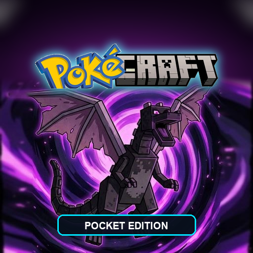

<p align="center">
  
  <br>
  <h1>⚡ PokéCRAFT — Pocket Edition (PE)</h1>
  <b>Pokémon Redstone Android Handheld Edition (v1.0.2)</b>
  <br>
  <i>Play as Minecraft Steve in FireRed Kanto with Full Survival, Block Mining & Crafting on Android</i>
</p>

<p align="center">
  <a href="https://github.com/ANBU007T/pokecraft-redstone-version-pocket-edition/releases"></a>
  <a href="https://github.com/ANBU007T/pokecraft-redstone-version-pocket-edition"></a>
  <a href="https://github.com/ANBU007T/pokecraft-redstone-version-pocket-edition/releases"></a>
  <a href="https://github.com/ANBU007T"></a>
  <a href="LICENSE"></a>
</p>

---

## 📱 Overview

**PokéCRAFT Pocket Edition (PE)** brings the full Pokémon Redstone x Minecraft crossover to Android mobile devices. Experience an authentic handheld retro-gaming feel powered by the custom **John GBA Mobile Emulator chassis**, responsive multi-touch haptics, adaptive hardware scaling, and an isolated 6-slot save manager.

* 🖥️ **Adaptive Display Scaling**: Instant in-game switching between Fit (3:2 Aspect), Pixel Crisp (Hardware Integer Scaling), and Stretch (Full Viewport Fill).
* 👥 **9 Playable Character Skins**: Full overworld sheets, battle backsprites, portraits, and armor sets for Steve, Alex, Zuri, Sunny, Noor, Makena, Kai, Efe, and Ari.
* 🌲 **Minecraft Survival Mechanics**: Punch trees, craft tools, place blocks, and manage hunger in the Pokémon world.
* ⚡ **Turn-Based Pokémon Battles**: Catch, train, and battle 151 Gen 1 Pokémon with authentic animations and cries.
* 🗺️ **High-DPI Kanto Town Map**: Sub-pixel accurate player tracking across outdoor routes and indoor buildings with a 51-location guidebook database.
* ⏩ **Turbo Fast-Forward**: Smooth 1x, 1.75x, and 2.5x speed multiplier toggles.
* 💾 **Independent 6-Slot Saves**: Visual screenshot thumbnails, playtime tracking, and `.sav` import/export.

---

## 🚀 What's New in v1.0.2

* **Adaptive Display Scaling Engine**:
  * **Fit (3:2 Aspect)**: Locks the authentic 3:2 Game Boy Advance cinema aspect ratio centered with black letterboxing/pillarboxing.
  * **Pixel Crisp (Integer Scaling)**: Device-pixel-ratio (DPR) aware integer multiplier (2x in portrait, 3x in landscape on 1080p display) for 100% sharp pixel art without blur or distortion.
  * **Stretch (Fill Display)**: Expands the canvas dynamically to utilize the full available screen viewport with touch controls automatically shifting to prevent overlap.
* **UI Immersion & Polish**:
  * Cleaned up the top HUD by removing the redundant map button and removing the full-width transparent bar under Quick Save / Load for a modern floating look.
* **Complete 9-Character Minecraft Skin Roster**:
  * Added all 9 selectable characters (Steve, Alex, Zuri, Sunny, Noor, Makena, Kai, Efe, and Ari) with complete overworld sheets, battle backsprites, UI dialogue portraits, held-item UV overlays, and diamond/iron/netherite armor sets with safe fallback protection.

---

## 📥 Download & Install

### Option 1: Direct Download (Ready to Play)
Download the signed APK directly from the repository or from [GitHub Releases](https://github.com/ANBU007T/pokecraft-redstone-version-pocket-edition/releases):
* 📦 **[Download PokeCraft-PE.apk (v1.0.2)](PokeCraft-PE.apk)** *(52.47 MB)*

1. Download `PokeCraft-PE.apk` to your Android device.
2. Open the downloaded file and tap **Install** *(enable "Install from Unknown Sources" if prompted)*.
3. Launch **PokéCRAFT PE** from your home screen or app drawer!

### Option 2: 1-Click USB ADB Installer (via PC)
1. Enable **Developer Options** and **USB Debugging** on your Android phone.
2. Connect your phone to your PC via USB.
3. Double-click **`Install-To-Phone.bat`**.
4. The game will automatically install and launch on your phone screen!

---

## 🎮 Virtual Touch Controls

The mobile chassis replicates the ergonomic handheld layout of classic Game Boy Advance emulators:

```
┌────────────────────────────────────────────────────────┐
│ [💾 SAVE] [📂 LOAD]                        [⏩ SPEED] [⚙️ MENU] │
├────────────────────────────────────────────────────────┤
│                                                        │
│                    GAME SCREEN (480x320)               │
│                                                        │
├────────────────────────────────────────────────────────┤
│  [L BUMPER]                                 [R BUMPER] │
│                                                        │
│       ▲                                        (B)     │
│    ◀  ●  ▶                                 (A+B)       │
│       ▼                                         (A)    │
│                                                        │
│   [SELECT]              [START]     [JUMP] [SPRINT] [INV]│
└────────────────────────────────────────────────────────┘
```

| Button | Action | In-Game Function |
| :--- | :--- | :--- |
| **D-Pad** | Up / Down / Left / Right | Move Steve in 4 directions |
| **A Button** | Primary Action | Talk, Confirm, Mine Block, Attack |
| **B Button** | Secondary Action | Cancel, Run, Place Block, Eat |
| **A+B Combo** | Simultaneous Action | Quick dual-action trigger |
| **L / R Bumpers** | Hotbar Cycle | Cycle equipped inventory items Left/Right |
| **SELECT** | Map | Open Kanto Overworld Region Map (🗺️) |
| **START** | Pokémon Menu | Open Party, Pokédex, Bag, and Trainer Card |
| **JUMP** | Jump | Leap over obstacles and ledges |
| **SPRINT** | Sprint Toggle | Boost Steve to 1.6x run speed |
| **INV** | Inventory | Open Minecraft crafting table and inventory grid |

---

## 🛠️ Building from Source

To compile the APK yourself using the automated Android toolchain:

### Prerequisites
* **Java JDK / JBR** (JDK 17 or JDK 21)
* **Android SDK Build-Tools** (`34.0.0` or `35.0.0`)
* **Python 3.10+** (with `Pillow` installed: `pip install pillow`)

### Build Command
```bash
python build_apk.py
```
The build pipeline compiles resources with `aapt2`, compiles Java with `javac`, converts bytecode to DEX with `d8`, aligns the package with `zipalign`, and signs with `apksigner`. The resulting signed APK is placed at `PokeCraft-PE.apk`.

---

## 📁 Repository Structure

```
pokecraft-redstone-version-pocket-edition/
├── PokeCraft-PE.apk          # Official signed Android APK release
├── PokeCraft_icon_512.png    # High-resolution 512x512 app launcher icon
├── Install-To-Phone.bat      # 1-Click ADB installer script
├── build_apk.py              # Zero-Gradle automated APK build toolchain
├── index.html                # Mobile HTML5 viewport & John-emulator HUD
├── john-emulator.js          # Virtual touch controller engine
├── john-emulator.css         # Responsive handheld GBA skin
├── controls_manager.js       # Touch event routing & key mapper
├── save_manager.js           # Independent 6-slot save system
├── settings.js / .css        # In-game settings & audio sliders
├── LICENSE                   # MIT License
├── README.md                 # Project documentation
└── POKECRAFT PE/             # Full native Android Studio project source
    └── app/src/main/
        ├── AndroidManifest.xml # Android hardware-acceleration config
        ├── java/...          # MainActivity.java WebView host
        ├── res/...           # Density-specific mipmap icons (mdpi to xxxhdpi)
        └── assets/www/       # Bundled game engine, assets, and sounds
```

---

## 👥 Credits & Attribution

### 🌟 Original Game Creator
* **Original Game**: **Pokémon Redstone** (Minecraft Steve in Pokémon FireRed)
* **Creator / Developer**: **MozeTech**
* **X (Twitter)**: [@mozetech](https://x.com/mozetech)
* Huge respect and gratitude to MozeTech for creating this brilliant and creative fan crossover game.

### 🛠️ Emulator & Mobile Architecture (v1.0.2 Update)
* **Emulator Creator**: **ANBU007T**
* **GitHub**: [@ANBU007T](https://github.com/ANBU007T)
* **Role**: PokéCRAFT Pocket Edition (PE) Architecture, Mobile Touch Controller, Fast-Boot Pipeline & Android Distribution
* **v1.0.2 Features Contributed**:
  * Adaptive Display Engine with DPR-aware Integer Scaling (Pixel Crisp), 3:2 Aspect Ratio (Fit), and Full Viewport Fill (Stretch)
  * Complete 9-character Minecraft skin roster integration (Steve, Alex, Zuri, Sunny, Noor, Makena, Kai, Efe, Ari) with armor sets and safe fallback rendering
  * Ergonomic handheld John GBA-style touchscreen virtual gamepad (D-Pad, Bumpers, Combos, Haptics)
  * High-DPI Kanto Town Map overhaul with sub-pixel accurate Steve GPS tracking & indoor-to-outdoor warp resolution
  * Complete 51-location Kanto guidebook database
  * Multi-speed turbo accelerator toggles (1x / 1.75x / 2.5x)
  * Isolated 6-slot save system (`pokecraft_mobile_slot_1..6`) with live screenshot previews
  * Zero-Gradle automated build pipeline (AAPT2, D8, apksigner)
  * Multi-density Android launcher icons & official 3D branding

### 🎮 Trademark Owners
* **Pokémon**: © Nintendo / Creatures Inc. / GAME FREAK inc. / The Pokémon Company
* **Minecraft**: © Mojang Studios / Microsoft Corporation

---

## ⚖️ Legal Disclaimer

This is an unofficial, non-commercial fan-made project created for educational and preservation purposes. Website sponsorships and external links are managed independently by the respective developers. Not affiliated with, endorsed by, or sponsored by Nintendo, Game Freak, Creatures, The Pokémon Company, Mojang, or Microsoft. Pokémon and Minecraft are registered trademarks of their respective owners.

